# Storefront Demo

A complete, working online store built to **show and explain how e-commerce works end to end** — catalog, search and filters, cart and wishlist, checkout, online payment, Cash on Delivery, order tracking, reviews, coupons — plus an **admin dashboard** for orders, products, inventory, customers, coupons and sales analytics.

> **All money is virtual.** Online payments go through **DemoPay**, a built-in payment gateway that works like Razorpay (gateway orders, signed callbacks, webhooks, refunds) but never touches a bank. Nothing is ever charged.

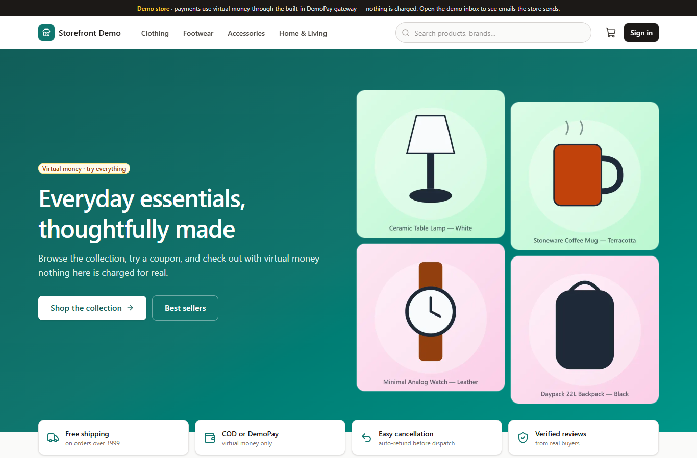

---

## Contents

1. [Run it on your computer](#1-run-it-on-your-computer)
2. [Demo accounts and coupons](#2-demo-accounts-and-coupons)
3. [Tour for shoppers (with pictures)](#3-tour-for-shoppers)
4. [Tour for the store admin (with pictures)](#4-tour-for-the-store-admin)
5. [It works on phones too](#5-it-works-on-phones-too)
6. [A 10-minute presentation script](#6-a-10-minute-presentation-script)
7. [What is real and what is simulated](#7-what-is-real-and-what-is-simulated)
8. [Tests](#8-tests)
9. [Useful commands](#9-useful-commands)
10. [Troubleshooting](#10-troubleshooting)
11. [How it is built](#11-how-it-is-built)

---

## 1. Run it on your computer

### What you need

| Tool | Version | Get it |
|---|---|---|
| **Node.js** | 22 or newer (24 LTS recommended) | <https://nodejs.org> — the installer includes `npm` |
| **Git** | any recent version | <https://git-scm.com> |

That is all. **No database, Docker, or payment/email accounts are needed** — the project starts its own MongoDB database automatically. Works on Windows, macOS and Linux.

### Steps

Open a terminal (on Windows: *PowerShell* or *Command Prompt*) and run:

```bash
# 1. Download the project
git clone https://github.com/reddypranith80-max/ecommerce-agent.git
cd ecommerce-agent

# 2. Install dependencies (first time only, takes 1–3 minutes)
npm install

# 3. Start everything
npm start
```

When you see these lines, it is ready:

```
[db]  MongoDB replica set ready at mongodb://127.0.0.1:27027/?replicaSet=rs0
[api] API listening on http://localhost:4000
[web] ➜  Local:   http://localhost:5173/
```

**4. Open <http://localhost:5173> in your browser.** 🎉

`npm start` runs three programs side by side in one terminal:

| Label | What it is | Address |
|---|---|---|
| `db` | MongoDB database (a real replica set, so transactions work) | `localhost:27027` |
| `api` | The server: business logic, payments, background jobs | `http://localhost:4000` |
| `web` | The website (React) | `http://localhost:5173` ← open this one |

**First run:** the database program (~62 MB) is downloaded once automatically, and the store fills itself with demo data — 30 products, a month of past orders, reviews and coupons. This needs an internet connection the first time only.

**To stop:** press `Ctrl + C` in the terminal. Your data is kept in the `.data/` folder for next time.

**To start fresh with clean demo data** (recommended before presenting):

```bash
npm run seed -- -- --reset
npm start
```

---

## 2. Demo accounts and coupons

| Role | Email | Password |
|---|---|---|
| Customer | `asha@demo.store` | `Shop@1234` |
| Store admin | `admin@demo.store` | `Admin@1234` |

The **Sign in** page has one-click buttons that fill these in. You can also create your own customer account.

| Coupon | What it does |
|---|---|
| `WELCOME10` | 10% off (up to ₹200) on orders over ₹499 · once per customer |
| `FLAT150` | ₹150 off orders over ₹1,499 |
| `FESTIVE25` | 25% off (up to ₹750) on orders over ₹2,000 · first 50 uses |
| `LASTUNIT` | ₹100 off · can be used **once in total** (shows usage limits) |
| `MONSOON20` | Expired — shows the "coupon has expired" message |

---

## 3. Tour for shoppers

### 3.1 Home page
The home page shows the featured collection, categories, deals of the week, trending products and new arrivals. Signed-in customers also get **"Recommended for you"** (based on what they bought) and everyone gets **"Recently viewed"**.

➡ Click a **category** in the top bar, type in the **search box** (suggestions appear as you type), or press **Shop the collection**.

### 3.2 Browse, search, filter and sort

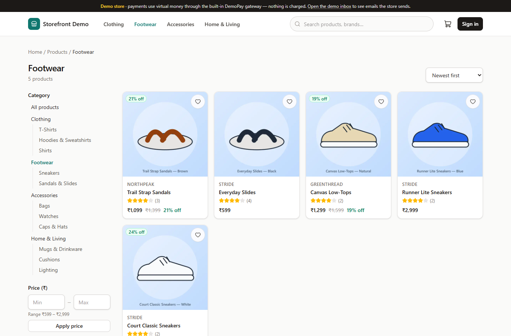

- **Filter** on the left: category (and sub-category), price range in ₹, minimum star rating, *in stock only*.
- **Sort** at the top right: newest, most popular, price low→high / high→low, top rated, or best match when searching.
- The address bar keeps your filters, so you can share or bookmark a filtered page. On a phone, tap **Filters** to show them.

### 3.3 Product page

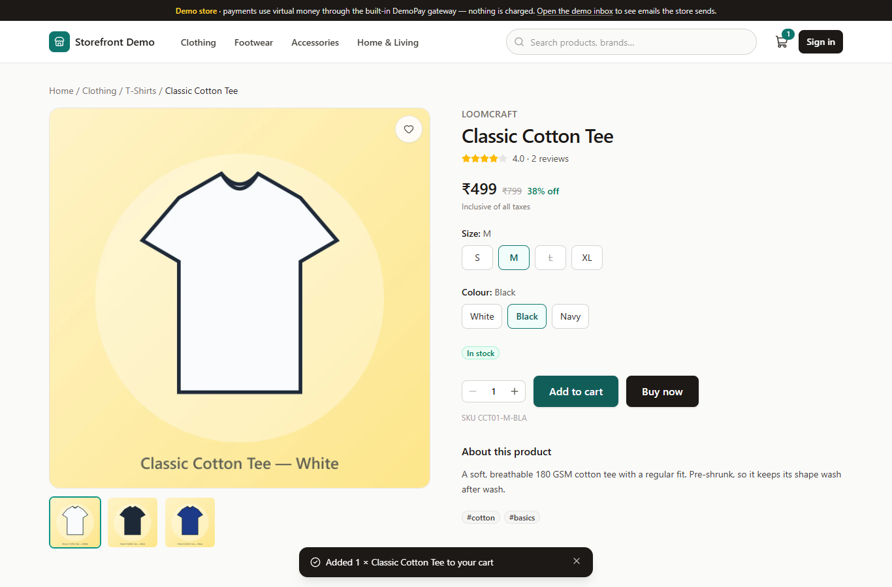

- Pick a **size** and **colour**. Combinations that are sold out are crossed out; impossible ones are greyed out.
- See the price, the original price (MRP) and the discount, live stock (*"Only 3 left"*), photos, description and **reviews from verified buyers**.
- Press **Add to cart** (or **Buy now** to go straight to the cart). The ♡ button saves it to your **wishlist** (needs sign-in).

### 3.4 Cart — works even before you sign in

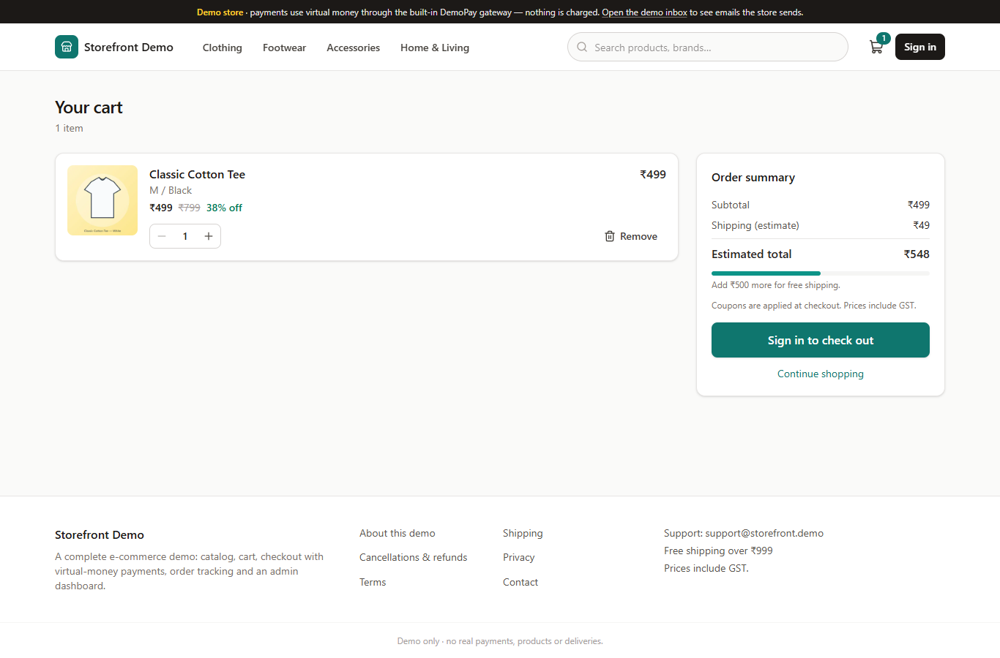

- Change quantities or remove items. Prices are always re-checked by the server; if a price changed since you added the item, you are told.
- A bar shows how much more you need for **free shipping** (over ₹999).
- Press **Sign in to check out**. Anything you put in the cart as a guest **moves into your account** when you sign in or register.

### 3.5 Checkout

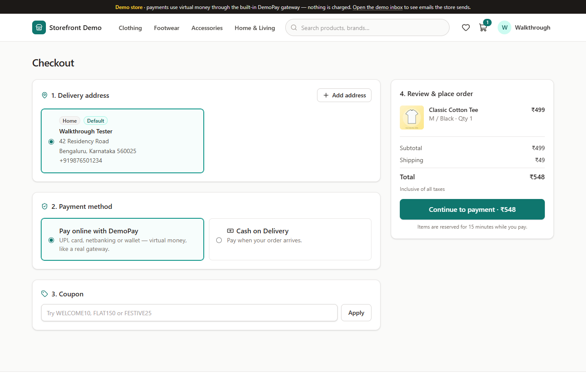

1. **Delivery address** — choose a saved one or add a new one (validated: 10-digit mobile number, 6-digit PIN code, state list).
2. **Payment method** — *Pay online with DemoPay* or *Cash on Delivery* (COD is unavailable for very large orders or if you already have 2 open COD orders; the reason is shown).
3. **Coupon** — type a code (e.g. `WELCOME10`) and press **Apply**. If it can't be used, the exact reason is shown.
4. **Review & place order** — totals are calculated by the server. Press **Continue to payment** (online) or **Place order** (COD).

### 3.6 Paying with DemoPay (virtual money)

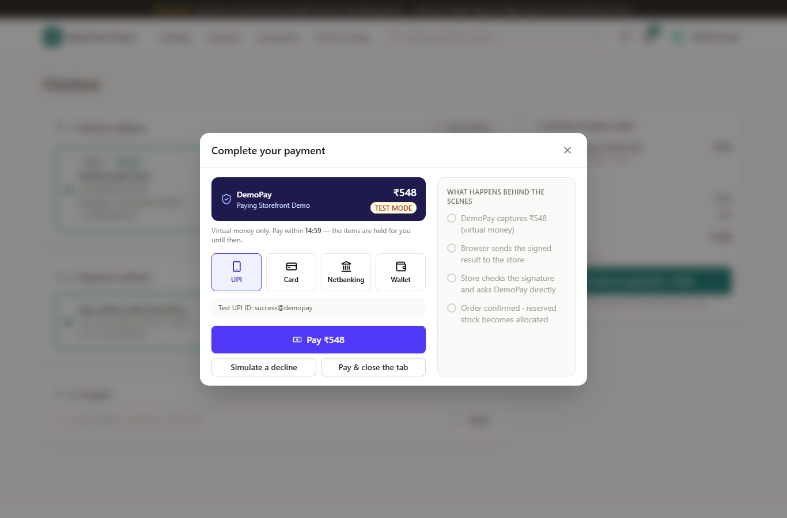

This window plays the role of a real payment page (like Razorpay Checkout). The panel on the right, **"What happens behind the scenes"**, ticks off each step live — great for explaining to an audience:

1. DemoPay takes the (virtual) money.
2. The browser sends a **signed** confirmation to the store.
3. The store **checks the signature and asks DemoPay directly** — it never trusts the browser alone.
4. The order is confirmed and the stock that was *reserved* becomes *allocated*.

Try all three buttons:

| Button | What it demonstrates |
|---|---|
| **Pay ₹…** | A normal successful payment |
| **Simulate a decline** | The bank says no. Nothing is charged; the order stays open and you can pay again |
| **Pay & close the tab** | The money is taken but the browser "disappears" before telling the store. A moment later the order page confirms itself anyway — DemoPay told the store through a **webhook** |

While you pay, the items are **held for you for 15 minutes** (countdown shown). If you never pay, the order expires and the items go back on sale.

### 3.7 Order confirmed, tracking and history

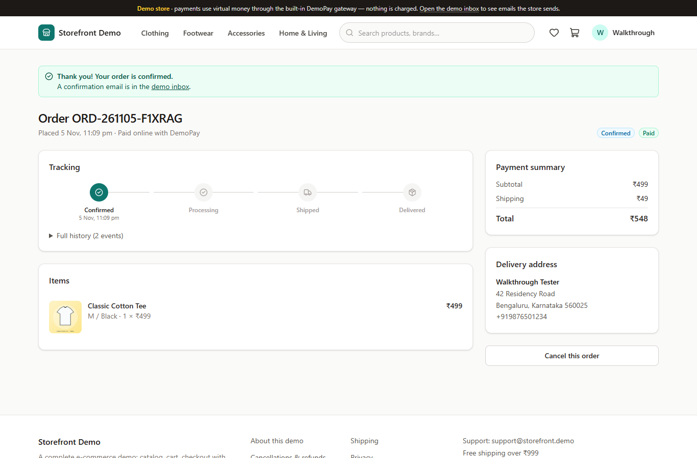

After the admin ships the order, the customer's order page shows the progress and the courier's tracking number:

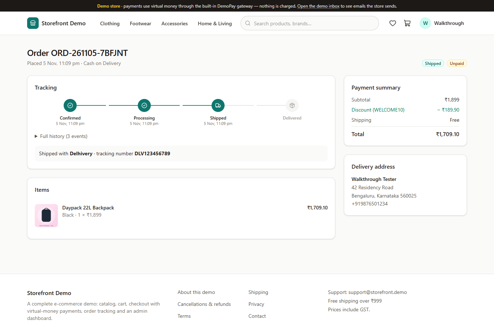

- **My orders** (account menu, top right) lists every order with its status, filterable by status:

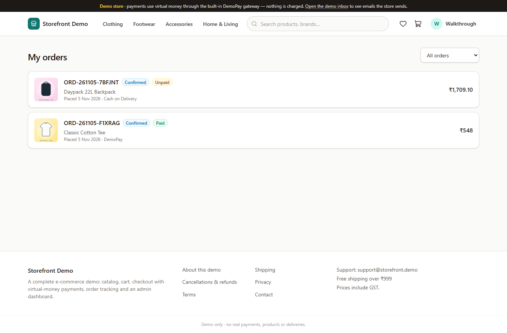

- **Cancel** an order yourself until it starts being packed. If you paid online, the **refund is automatic** (virtual money) and its status appears on the order.
- Once an order is **delivered**, a **Write a review** link appears for each item. Only verified buyers can review.

### 3.8 Demo inbox — see the emails the store sends

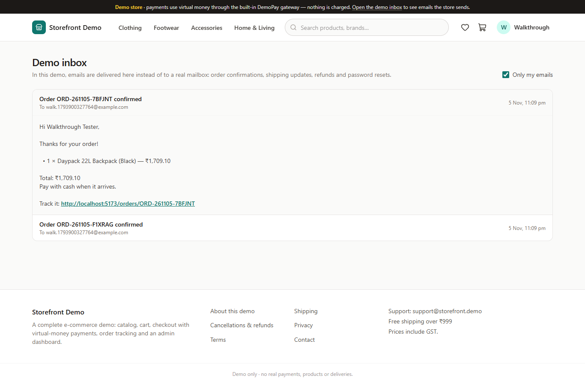

Order confirmations, shipping updates, refunds and **password-reset links** are delivered to the **Demo inbox** (link in the black banner at the top) instead of a real mailbox. Try **Forgot password?** on the sign-in page, then open the link from the inbox.

### 3.9 Your account
Account menu → **Account & addresses**: edit your name and phone number, manage up to 10 addresses (one default), and change your password (this signs you out on all other devices).

---

## 4. Tour for the store admin

Sign in as **admin@demo.store / Admin@1234** — you land on the dashboard. (**View store** at the top right takes you back to the shop.)

### 4.1 Dashboard

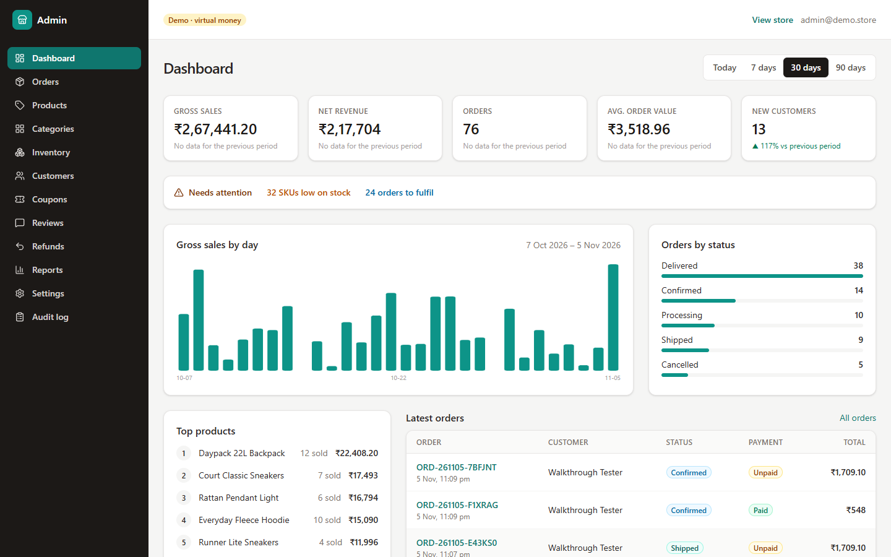

- Choose a period: **Today / 7 / 30 / 90 days**. Tiles show gross sales, net revenue (money received minus refunds), number of orders, average order value and new customers, compared with the previous period.
- **Needs attention** links straight to low-stock items, orders waiting to be shipped, refunds in progress or failed, and orders flagged for review.
- Below: sales per day chart, orders by status, top products and the latest orders.

### 4.2 Orders — process and ship

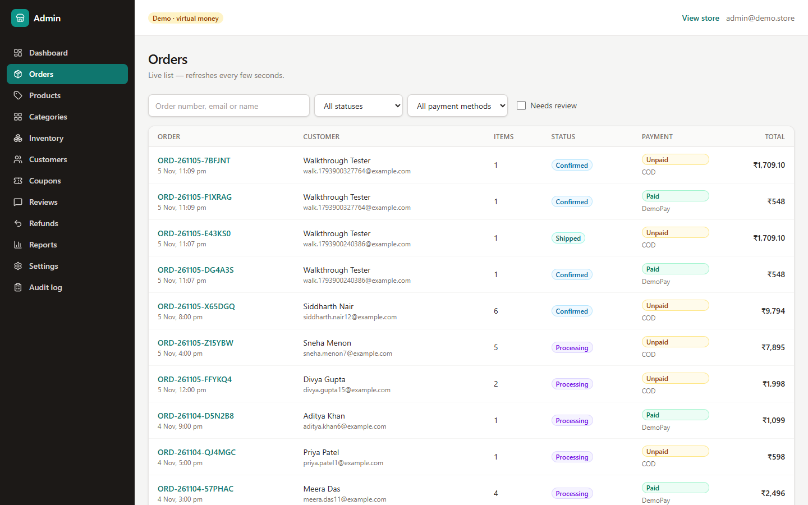

Search by order number, email or name, and filter by status, payment method or *needs review*. Open an order:

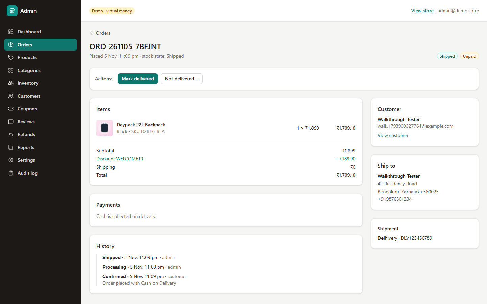

The **Actions** bar only offers the steps that are allowed next:
**Start processing → Mark shipped** (choose the courier and enter a tracking number) **→ Mark delivered**. A COD order becomes *paid* when it is delivered.
You can also **Cancel** (paid orders are refunded automatically) or mark an order **Not delivered** (returned, refused or lost — stock is put back unless it was lost). Shipping, delivery and cancellation are emailed to the customer, and every step is recorded in the order's history.

### 4.3 Products and categories

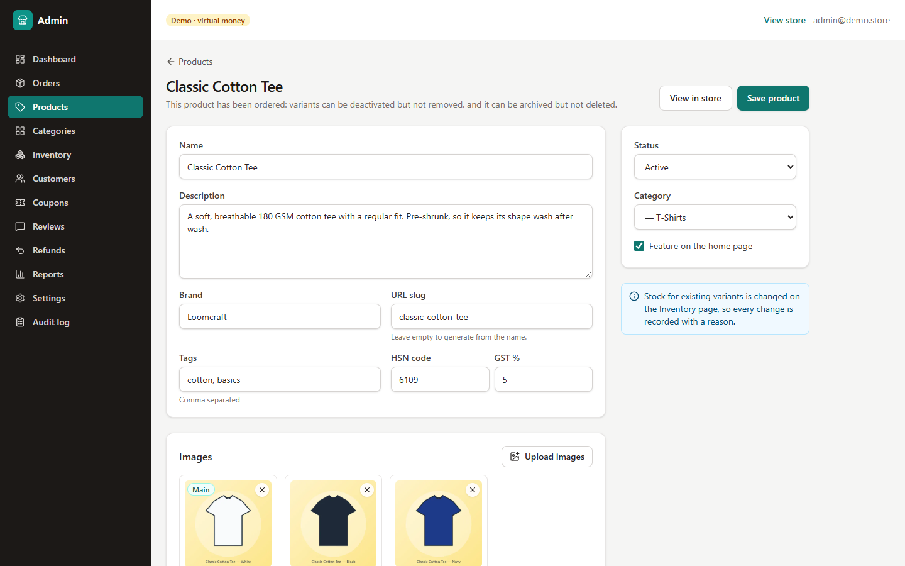

- **Products → New product**: name, description, brand, category, status (*draft / active / archived*), "feature on the home page", images (JPEG/PNG/WebP/AVIF, resized and converted automatically — reorder with the arrows, the first is the main image).
- **Options & variants**: enter options such as `Size: S, M, L` and `Colour: Black, White`, press **Generate variants**, then set each variant's SKU, price, MRP and opening stock.
- A product that has been ordered can be **archived** but not deleted, so order history stays intact.
- **Categories**: up to three levels (e.g. *Clothing → T-Shirts*). Use **+ Sub** to add a sub-category.

### 4.4 Inventory

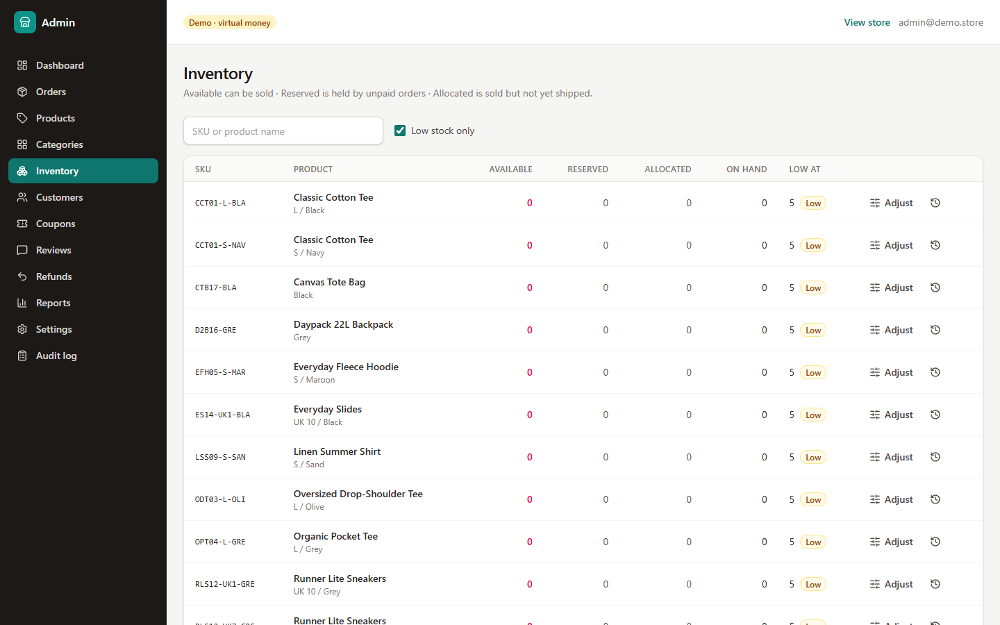

Every product variant (SKU) shows three numbers:

| Column | Meaning |
|---|---|
| **Available** | Can be sold right now |
| **Reserved** | Held for customers who are paying at this moment |
| **Allocated** | Sold, waiting to be shipped |

Tick **Low stock only** to see what to reorder. **Adjust** adds stock (*restock*) or corrects it (*adjustment*, with a reason). The 🕘 history button shows every stock movement — sales, reservations, cancellations, restocks — with who did it and for which order.

### 4.5 Reports

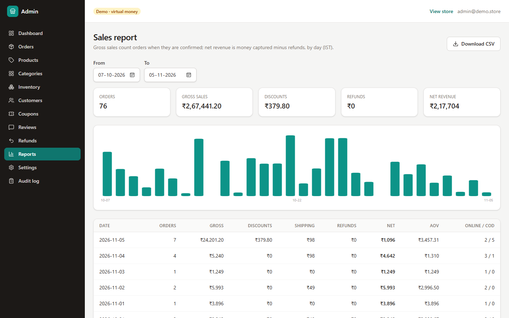

Pick a date range to see orders, gross sales, discounts, shipping, refunds and net revenue per day. **Download CSV** opens it in Excel or Google Sheets.

### 4.6 Everything else in the admin menu

| Page | What you can do |
|---|---|
| **Customers** | Search customers, see their addresses, orders and lifetime spend; **block** a customer (signs them out instantly and cancels their unpaid orders) or unblock them |
| **Coupons** | Create percentage or fixed-amount coupons with minimum order, maximum discount, dates and usage limits; click the *Used* number to see which orders used it |
| **Reviews** | Hide or delete inappropriate reviews; the product's star rating is recalculated |
| **Refunds** | Every refund and its status (*requested → initiated → processed*); retry a failed one |
| **Settings** | Store name, shipping fee and free-shipping threshold, Cash on Delivery rules, payment window, home-page headline. **Demo tools**: make DemoPay "go down" for the next order to show the *retry payment* flow |
| **Audit log** | Who changed what, and when |

**Tip for a live demo:** in **Settings**, set *Payment window* to **2** minutes and *Grace period* to **0**. Start an online order and don't pay — within a few minutes it shows *Expired* and its stock returns in **Inventory**.

---

## 5. It works on phones too

<p align="center">
  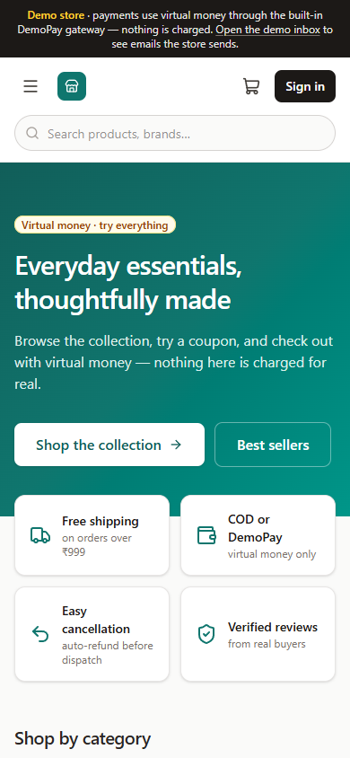
  &nbsp;
  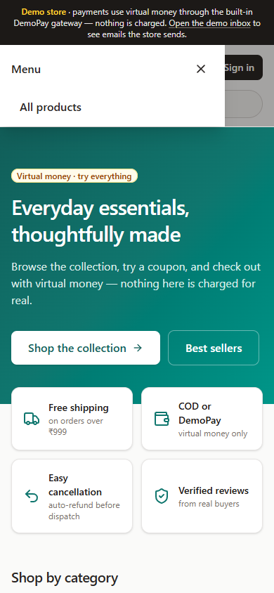
  &nbsp;
  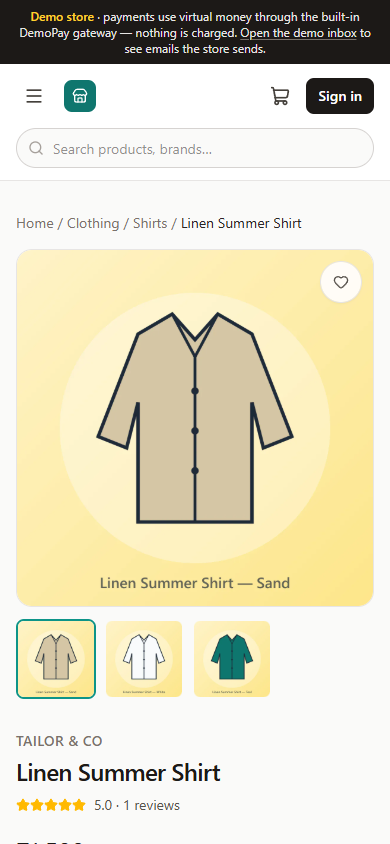
</p>

To try it on your own phone: connect the phone to the same Wi-Fi as the computer, stop `npm start`, run **`npm run start:lan`** instead, and open the *Network* address it prints (e.g. `http://192.168.1.20:5173`) on the phone.

---

## 6. A 10-minute presentation script

1. **Browse** — home page → a category → search "shirt" → filter by price and rating → sort by price.
2. **Product** — pick a size and colour (point out the crossed-out sold-out sizes) → **Add to cart** without signing in.
3. **Sign in** as Asha → the guest cart is now in her account.
4. **Checkout** → apply `WELCOME10` → **Continue to payment** → **Pay**. Walk through the four steps on the right of the DemoPay window.
5. Place another order and choose **Pay & close the tab** → show the order confirming itself from the webhook.
6. Place a **Cash on Delivery** order.
7. Open the **Demo inbox** → the confirmation emails.
8. Sign in as **admin** (use a private/incognito window to stay signed in as both) → **Dashboard** → **Orders** → open the COD order → **Start processing → Mark shipped → Mark delivered**.
9. Back as Asha → the order shows the tracking timeline → **Write a review**.
10. As Asha, **cancel** the paid order → refund processed automatically → see it in **Admin → Refunds** and the stock back in **Inventory**.

---

## 7. What is real and what is simulated

| Real (fully implemented) | Simulated for the demo |
|---|---|
| MongoDB database with transactions, indexes and a rule that stock can never go negative | MongoDB runs locally from a downloaded binary instead of a hosted service |
| Accounts, secure sessions (short-lived tokens + rotating, httpOnly refresh cookie), password reset | Emails go to the in-app **Demo inbox** instead of a mail provider |
| Server-side pricing, coupons, stock reservation, no overselling under simultaneous orders | Payments use **DemoPay** (virtual money) instead of Razorpay |
| Payment signature checks, webhooks, duplicate protection, automatic refunds, reconciliation | Product photos are generated illustrations |
| Admin dashboard, analytics, inventory ledger, audit log | Tracking numbers are typed in by the admin (no courier integration) |

---

## 8. Tests

```bash
npm test            # 39 automated tests (unit + API, uses a temporary in-memory database — no setup)
npm run typecheck   # strict TypeScript checks for all three packages
```

There is also a **browser walkthrough** that clicks through the whole store like a real person (14 steps: browse, cart, sign-up, both payment methods, admin shipping an order, phone layout) and saves the screenshots used in this README. It uses **Microsoft Edge** installed on the computer. With the app running (`npm start`), in a second terminal:

```bash
node tests/e2e/walkthrough.mjs docs/images
```

Some things the automated tests prove: 6 people buying the last 2 units at the same moment → exactly 2 succeed; a single-use coupon used by 3 people at once → only 1 succeeds; forged payment signatures are rejected; a refund job that runs twice still refunds only once; money paid after an order was cancelled is refunded automatically; customers cannot see or change each other's data.

---

## 9. Useful commands

| Command | What it does |
|---|---|
| `npm install` | Install dependencies (first time, or after pulling changes) |
| `npm start` | Start database + API + website |
| `npm run start:lan` | Same, but the website is also reachable from phones on your Wi-Fi |
| `npm run seed -- -- --reset` | Wipe everything and load fresh demo data (stop `npm start` first) |
| `npm test` | Run the automated tests |
| `npm run typecheck` | Check types in all packages |
| `npm run build` | Build the website for production (`client/dist`) |
| `npm run create-admin -w @shop/server -- you@example.com "Your Name"` | Create an extra admin account (asks for a password) |

---

## 10. Troubleshooting

| Problem | Fix |
|---|---|
| `Port 5173 is already in use` / `EADDRINUSE :4000` | `npm start` is already running in another terminal — use that one, or close it. On Windows, `netstat -ano \| findstr :5173` shows the process ID to end in Task Manager |
| The page says **"Cannot reach the server. Is it running?"** | The `api` part stopped — check the terminal for a red error and run `npm start` again |
| First start hangs at *"Locating MongoDB binary"* | It is downloading MongoDB (~62 MB). Needs internet once; behind a proxy, set the `HTTPS_PROXY` environment variable |
| `[db] mongod exited` | Another MongoDB may be using port 27027, or the data folder is damaged: stop everything, delete the `.data` folder, then `npm start` (demo data is recreated) |
| A coupon says *"You have already used this coupon"* | Coupons have per-customer limits. Create a new account or reset the demo data |
| Want everything back to the start | Stop `npm start`, run `npm run seed -- -- --reset`, then `npm start` |

---

## 11. How it is built

```
client/   React 19 + Vite + TypeScript + Tailwind CSS — storefront and /admin (TanStack Query, Zustand, React Hook Form)
server/   Node.js + Express 5 + TypeScript + Mongoose — REST API, DemoPay simulator, background jobs, seed data
shared/   Zod validation schemas, pricing rules, order status rules and types used by both sides
tests/    Browser walkthrough (Microsoft Edge)
docs/     Requirements, screenshots
```

Highlights: integer paise for all money (no rounding errors) · MongoDB transactions plus conditional updates so stock can never be oversold · idempotency keys so a double-click never creates two orders · JWT access tokens kept in memory and rotating httpOnly refresh cookies · webhook signature checks and duplicate-event protection · uploaded images re-encoded for safety · role-based permissions checked on the server for every admin action.

More detail: [ARCHITECTURE.md](ARCHITECTURE.md) · [API_DOCUMENTATION.md](API_DOCUMENTATION.md) · [docs/REQUIREMENTS.md](docs/REQUIREMENTS.md) · [IMPLEMENTATION_PLAN.md](IMPLEMENTATION_PLAN.md) · [PROJECT_STATUS.md](PROJECT_STATUS.md)

**Configuration (optional):** everything has working defaults. To change ports, secrets or behaviour, copy `server/.env.example` to `server/.env` and edit it. In production mode (`NODE_ENV=production`) the server refuses to start until real secrets are set.
